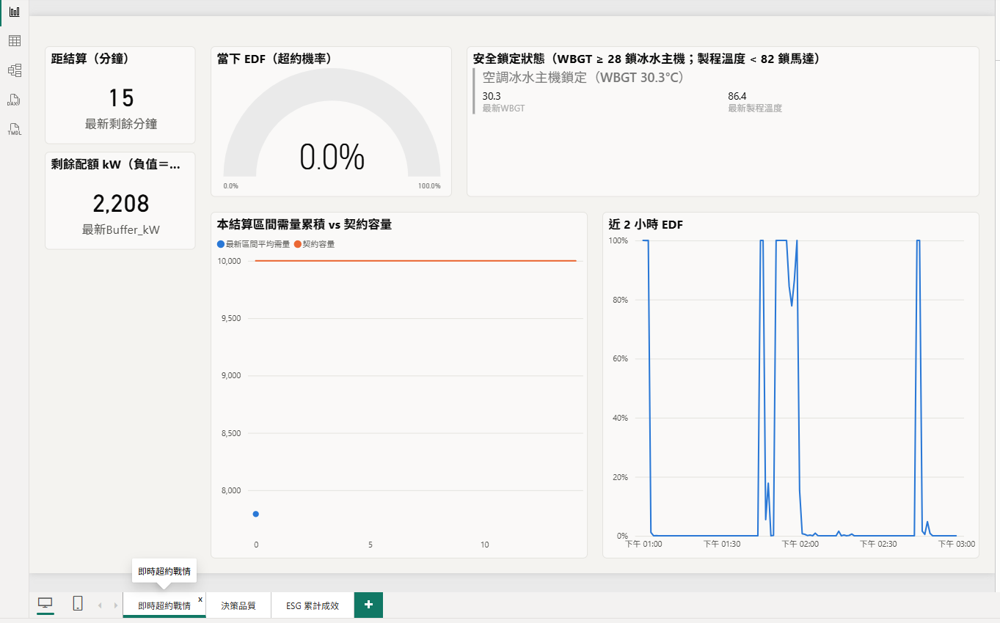

# 作品集

課程與專案作品。每個資料夾是一個獨立專案，點進去看各自的說明。

| 專案 | 類型 | 一句話說明 | 狀態 |
| --- | --- | --- | --- |
| **[數位儀表板-mysql](數位儀表板-mysql/)** | 資料分析 × 數位儀表板 | 用 KMV 信用風險模型預警工廠尖峰用電超約，並以 ESG 價值挑選卸載方案，Power BI 呈現 | ✅ 線上運作中（Railway） |
| [PMP專案管理實務](PMP專案管理實務/) | 專案管理 | 「長照資訊大管家」商業計畫書與簡報 | 📄 文件 |

---

## 數位儀表板-mysql：KMV 尖峰電力超約預警 × ESG 決策系統



台電以 15 分鐘平均需量計算超約。這個系統把金融業評估違約機率的 **KMV 模型**拿來估算「這 15 分鐘會不會超約」，風險高時由決策引擎在 7 種卸載組合中，綜合避免的罰款、產能損失、碳排變化與安全風險，挑出最划算的方案。

- **Python**：模擬工廠負載與環境、計算超約機率（EDF）、決策引擎、碳預算追蹤，每 60 秒寫入一筆
- **MySQL**（Railway 雲端）：6 張結果表，資料庫只存結果、不做計算
- **Power BI**：三個頁面分別給值班人員、廠務主管、管理層看

| 想做什麼 | 看這裡 |
| --- | --- |
| 打開 Power BI 報表 | [數位儀表板-mysql/README.md](數位儀表板-mysql/README.md)（3 步驟，含 MySQL 連接器安裝） |
| 了解模型公式與規格 | [規格書 SPEC.md](數位儀表板-mysql/docs/SPEC.md) |
| 部署與維運 | [DEPLOY_RAILWAY.md](數位儀表板-mysql/DEPLOY_RAILWAY.md) |

**使用技術**：Python（numpy、scipy、pandas）、MySQL、Power BI（Power Query、DAX、PBIP 專案格式）、Docker、Railway

> 第一版使用 PostgreSQL + Zeabur，Zeabur 停止服務後已改為現在的 Railway + MySQL 版；舊版已移至私人 repo 保存。

---

## PMP專案管理實務

以 PMP 專案管理方法撰寫的「長照資訊大管家」提案。

| 檔案 | 說明 |
| --- | --- |
| `長照資訊大管家商業計畫書.docx` | 商業計畫書 |
| `長照資訊大管家 商業計畫簡報.pptx` | 商業計畫簡報 |
| `PMP/` | 各版本的計畫書與簡報（含修正版、終版） |

---

## 資料夾結構

```
my-portfolio/
├── 數位儀表板-mysql/        ← KMV × ESG 系統（現行版：Railway + MySQL）
└── PMP專案管理實務/          ← 長照資訊大管家 商業計畫書與簡報
```
