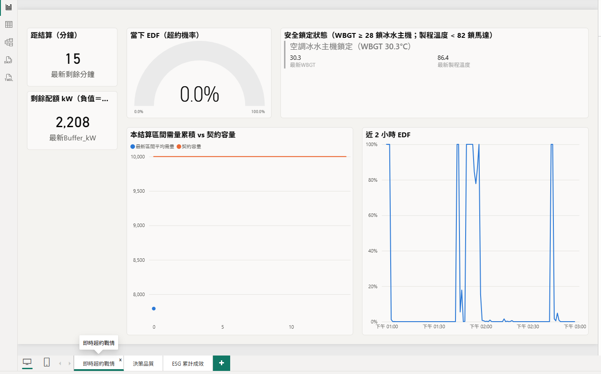
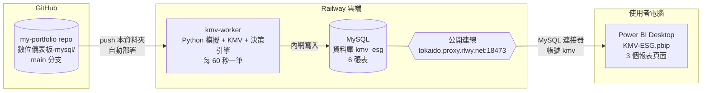
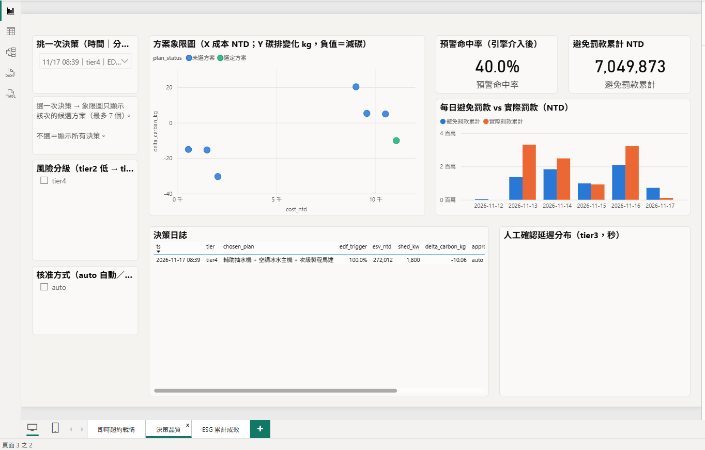
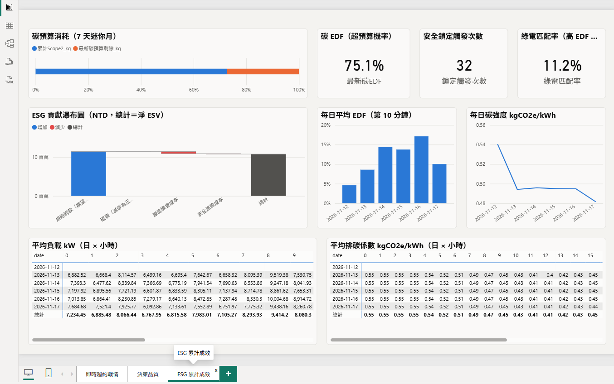

# KMV 尖峰電力超約預警 × ESG 決策系統

用金融信用風險的 **KMV 模型**估算工廠「這 15 分鐘會不會超過契約容量」的機率（EDF），超約風險高時由決策引擎在「降載省罰款」與「降載的碳排、產能、安全代價」之間挑出最划算的方案，結果用 Power BI 呈現。



---

## 我只想打開報表看（3 步驟）

> 需要：Windows 電腦、[Power BI Desktop](https://aka.ms/pbidesktopstore)（免費）、資料庫密碼（向專案負責人索取）

### 步驟 1：安裝 MySQL 連接器（**必裝**，每台電腦裝一次）

報表的資料放在雲端 MySQL，Power BI 要靠 **MySQL Connector/NET** 才連得上。沒裝的話會出現：

```
找不到具有不變名稱 'MySql.Data.MySqlClient' 的資料庫提供者
```

- 安裝檔在本專案的 **[`tools/`](tools/)** 資料夾，雙擊執行、選 **Typical** 一路下一步。
- 若 `tools/` 裡沒有，到 <https://dev.mysql.com/downloads/connector/net/> 下載「Windows (x86, 64-bit), MSI Installer」（登入頁點 *No thanks, just start my download*）。
- 裝完**完全關閉 Power BI Desktop 再重開**。

### 步驟 2：開啟報表

1. 下載本資料夾：在 GitHub 的 [my-portfolio](https://github.com/p250808-ls/my-portfolio) 按綠色 **Code → Download ZIP**，解壓縮後進入 **`數位儀表板-mysql/`**。
   （或用 `git clone https://github.com/p250808-ls/my-portfolio.git`）
2. 進入 **`powerbi/`** 資料夾，雙擊 **`KMV-ESG.pbip`**。

   > `KMV-ESG.pbip`、`KMV-ESG.Report/`、`KMV-ESG.SemanticModel/` 三者要放在同一個資料夾，不能只拿 .pbip。
   >
   > 若 Power BI 說不認得 .pbip：檔案 → 選項及設定 → 選項 → 預覽功能 → 勾選「Power BI 專案 (.pbip) 儲存選項」，重開。

### 步驟 3：重新整理並登入

剛開啟時圖表是空的（檔案只含報表設計，不含資料）。按上方 **常用 → 重新整理**，跳出登入視窗時：

| 欄位 | 填寫 |
| --- | --- |
| 驗證種類 | **資料庫**（不是 Windows） |
| 使用者名稱 | `kmv` |
| 密碼 | 向專案負責人索取 |
| 使用加密連線 | **要勾選**（不勾會出現「找不到要求的值 'None'」） |

約 1 分鐘載入完成，三個頁面都會有資料。之後按「重新整理」即可取得最新資料（每 60 秒新增一筆）。

### 常見問題

| 看到的訊息 | 原因與處理 |
| --- | --- |
| 找不到 `MySql.Data.MySqlClient` | 沒裝 MySQL 連接器 → 步驟 1，裝完重開 Power BI |
| 找不到要求的值 `'None'` | 沒勾「使用加密連線」→ 檔案 → 選項及設定 → 資料來源設定 → 編輯權限，勾選加密 |
| `Access denied for user` | 帳號或密碼錯；使用者名稱是 `kmv`，不是 `kmv_esg` |
| 圖表全部是「(空白)」 | 還沒重新整理 → 常用 → 重新整理 |
| 一或多個關聯性已修改，需手動重新整理 | 第一次開啟的正常提示，按「立即重新整理」 |

---

## 系統架構



| 元件 | 做什麼 | 在哪裡 |
| --- | --- | --- |
| **kmv-worker** | 模擬工廠負載 → 算超約機率 EDF → 決策 → 寫入資料庫；每 7 天清空重來 | Railway 專案 victorious-amazement |
| **MySQL** | 存 6 張結果表；與其他展示專案共用，但 `kmv_esg` 資料庫與 `kmv` 帳號獨立 | 同上 |
| **Power BI 報表** | 只讀取、不計算；所有模型數字都由 Python 算好 | `powerbi/KMV-ESG.pbip` |

> 設計原則：**所有模型邏輯都在 Python**。資料庫沒有 view／trigger，Power BI 的 DAX 只做取最新值、加總、平均等顯示用途。

---

## 報表三個頁面

| 頁面 | 給誰看 | 回答什麼問題 |
| --- | --- | --- |
| **即時超約戰情** | 值班人員 | 這 15 分鐘還剩幾分鐘？超約機率多高？有沒有設備被安全鎖定不能關？ |
| **決策品質** | 廠務主管 | 每次決策挑了哪個方案、為什麼？預警準不準？省了多少罰款？ |
| **ESG 累計成效** | 管理層 | 碳預算用了多少？省罰款的同時碳排是增是減？哪些時段高負載碰上高排碳？ |

<details>
<summary>決策品質、ESG 累計成效 截圖</summary>




</details>

---

## 文件

| 文件 | 內容 |
| --- | --- |
| **[docs/SPEC.md](docs/SPEC.md)** | **規格書**：模型公式、決策規則、資料表欄位、報表規格、參數 |
| [POWERBI_GUIDE.md](POWERBI_GUIDE.md) | Power BI 手動建置與修改（量值 DAX、條件式色彩、驗證 SQL） |
| [DEPLOY_RAILWAY.md](DEPLOY_RAILWAY.md) | Railway 部署、共用 MySQL、改參數、灌測試資料 |

## 專案結構

```
數位儀表板-mysql/
├── README.md                 ← 本檔
├── docs/SPEC.md              ← 規格書
├── tools/                    ← MySQL Connector/NET 安裝檔
├── powerbi/
│   ├── KMV-ESG.pbip          ← 用 Power BI Desktop 開這個
│   ├── KMV-ESG.Report/       ← 報表版面（3 頁）
│   ├── KMV-ESG.SemanticModel/← 資料模型（連線、6 張表、關聯、量值）
│   ├── KMV_ESG_theme.json    ← 配色佈景主題（報表已內含，備用）
│   └── generate_pbip.py      ← 產生以上報表檔的程式
├── main.py                   ← worker 進入點（排程）
├── engine.py                 ← 每分鐘流程：模擬 → KMV → 決策 → 結算 → 碳預算
├── simulator.py              ← 負載與環境（排碳係數、綠電、WBGT、製程溫度）模擬
├── kmv.py                    ← EDF、罰款期望值、碳預算 EDF
├── decision.py               ← 7 種卸載組合的 ESV、安全鎖定、四級分級
├── writer.py                 ← 寫入 MySQL／PostgreSQL
├── config.py                 ← 全部參數
├── sql/schema_mysql.sql      ← 資料表定義（MySQL，使用中）
├── sql/schema.sql            ← 資料表定義（PostgreSQL 版）
├── analyze.py / backtest.py / calibrate.py ← 分析、回測、校準工具
├── Dockerfile               ← Railway 建置（python main.py）
└── requirements.txt
```

---

## 開發者：在自己電腦跑模擬

```bash
pip install -r requirements.txt
python main.py --dry-run --days 1          # 不接資料庫，只印摘要（最快的試跑方式）
```

接資料庫（`.env` 參考 `.env.example`，`mysql://` 開頭用 MySQL，`postgresql://` 開頭用 PostgreSQL）：

```bash
python main.py                             # 真實時間，每 60 秒一筆
python main.py --speed 0 --days 3 --start 2026-11-15T00:00   # 快速灌 3 天資料（會先清空資料表）
python analyze.py                          # 印出摘要與決策範例
python backtest.py --days 7 --windows 15 30 60
python calibrate.py --hours 48 --auto
```

改報表版面：編輯 `powerbi/generate_pbip.py` 後執行 `python powerbi/generate_pbip.py`，再用 Power BI Desktop 重新開啟（會覆蓋在 Desktop 裡手動做的修改）。
