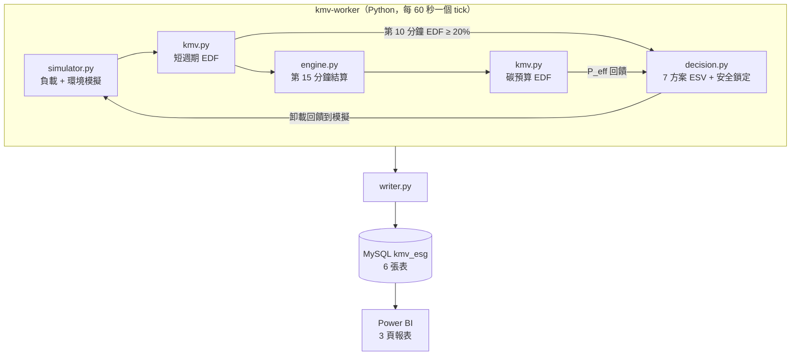

# 規格書：KMV 尖峰電力超約預警 × ESG 決策系統

| 項目 | 內容 |
| --- | --- |
| 文件版本 | 2.0（Railway + MySQL 版） |
| 程式語言 | Python 3.12（numpy、scipy、pandas、PyMySQL） |
| 資料庫 | MySQL 8（Railway），資料庫 `kmv_esg`；亦支援 PostgreSQL |
| 視覺化 | Power BI Desktop（`powerbi/KMV-ESG.pbip`） |
| 參數來源 | `config.py`（下文 `C.參數名`） |

---

## 1. 目的與範圍

台電以 **15 分鐘平均需量**計算超約：平均需量超過契約容量時，超出的 kW 要付附加費。本系統：

1. **預警**：在每個 15 分鐘結算區間內，每分鐘用 KMV 模型估算「結算時超約的機率」（EDF）。
2. **決策**：第 10 分鐘 EDF ≥ 20% 時，評估 7 種卸載組合，以 **ESG 價值（ESV）**選出方案：同時考慮避免的罰款、停機的產能損失、碳排變化與安全風險。
3. **碳預算**：以 7 天為一個「迷你月」，追蹤 Scope 2 排放對碳預算的消耗，算出超預算機率（carbon EDF），並回饋到碳價。
4. **呈現**：寫入 6 張資料表，Power BI 三個頁面只讀取呈現。

**範圍外**：真實電表接入、實際控制設備、Power BI 服務發佈與排程重新整理。負載與環境均為模擬資料。

---

## 2. 系統架構



### 2.1 執行模式（`main.py`）

| 指令 | 用途 |
| --- | --- |
| `python main.py` | 真實時間：每 60 秒一筆，寫入 `DATABASE_URL`（Railway 上的預設） |
| `python main.py --speed 0 --days N --start YYYY-MM-DDTHH:MM` | 加速：不等待，一次跑完 N 天（灌展示資料；會先清空資料表） |
| `python main.py --dry-run --days 1` | 不連資料庫，印摘要 |
| `python main.py --engine off` | 關閉決策引擎（校準用） |
| `python main.py --init-db` | 重建資料表後結束 |

### 2.2 週期與重啟

- **7 天週期**：週期起點（epoch）= `power_reading` 第一筆 `ts`。滿 `C.RESET_DAYS`（7）天時清空 6 張表並以當下為新起點，`interval_id`、`decision_id` 從 1 重新編號。
- **重啟**：真實時間模式重啟時沿用既有起點，`interval_id` 連續；重啟落在區間中段時，缺少的分鐘以當前負載補齊。
- **時間**：全部以 Asia/Taipei 計算；MySQL `DATETIME` 存台北當地時間。

---

## 3. 模擬模型（`simulator.py`）

### 3.1 負載

```
總負載 = 基礎負載 × 日係數 + 週期性製程負載 + 隨機跳動 + 偶發尖峰 − 卸載中負載
```

| 成分 | 規格 | 參數 |
| --- | --- | --- |
| 基礎負載 | 契約容量 × 78% | `BASE_LOAD_FRAC = 0.78` |
| 日係數 | 白天 1.0、夜間（22:00–06:00）0.85，前後 1 小時線性過渡 | `NIGHT_FACTOR` |
| 週期性製程負載 | 正弦波，週期 3 小時、振幅契約容量 10% | `SINE_PERIOD_HOURS`、`SINE_AMP_FRAC` |
| 隨機跳動 | 常態分布，σ = 契約容量 4% | `NOISE_SIGMA_FRAC` |
| 偶發尖峰 | 平均每小時 2 次、持續 2–6 分鐘、幅度契約容量 45%–55% | `SPIKE_*` |
| 卸載 | 決策執行後扣除 `shed_kw`，持續到該區間結算後恢復；恢復期（`recovery_min`）內馬達的製程溫度逐分鐘回升 | `LOADS` |

尖峰幅度經校準：規格初值 20%–30% 只得 0.3% 超約，調到 45%–55% 時引擎關閉下超約比例約 8%（目標 8%–12%）。

### 3.2 環境變數

| 變數 | 模型 | 用途 |
| --- | --- | --- |
| `grid_ef` 排碳係數（kgCO2e/kWh） | 24 小時曲線線性插值（深夜 0.55、正午 0.40、傍晚 0.52）+ σ 0.01 雜訊 | 碳排計算 |
| `renewable_pct` 綠電占比（%） | 06:00 起升、12:00 達 35%、18:00 歸零 | 綠電匹配率 |
| `wbgt` 綜合溫度熱指數（°C） | 由氣溫（日均 26°C ± 3.5°C，15:00 最高）與相對濕度 60% 以近似式計算 | 冰水主機安全鎖定 |
| `process_temp` 製程溫度（°C） | 86°C ± 6 小時慢速漂移 4°C；卸載馬達時每分鐘降 0.4°C、恢復時升 0.2°C | 馬達安全鎖定 |

### 3.3 可卸載負載

| key | 名稱 | 卸載 kW | 恢復（分） | 產能成本 NTD | 回溫碳排 kg | 報廢機率 | 報廢碳排 kg | 安全成本 NTD | 鎖定規則 | tier2 可用 |
| --- | --- | ---: | ---: | ---: | ---: | ---: | ---: | ---: | --- | --- |
| pump | 輔助抽水機 | 400 | 5 | 1,500 | 0 | 0 | 0 | 0 | 無 | 是 |
| chiller | 空調冰水主機 | 600 | 15 | 0 | 8 | 0 | 0 | 300 | WBGT ≥ 28°C 鎖定 | 是 |
| motor | 次級製程馬達 | 800 | 30 | 8,000 | 45 | 10% | 60 | 1,000 | 製程溫度 < 82°C 鎖定 | 否 |

---

## 4. 短週期 KMV：超約機率 EDF（`kmv.py`）

每分鐘計算，`t = minute_in_interval + 1`（1–15），`n = 15`。

| 量 | 公式 |
| --- | --- |
| 單分鐘波動 σ_kw | 近 30 分鐘負載樣本標準差，下限 50 kW（`SIGMA_WINDOW_MIN`、`SIGMA_FLOOR_KW`） |
| 預估結算平均需量 | `projected = (Σ 已發生負載 + 當前負載 × (n − t)) / n` |
| 剩餘配額 buffer | `buffer_kw = 契約容量 − projected` |
| 平均需量的波動 | `σ_avg = σ_kw × √(n − t) / n` |
| 違約距離 DD | `DD = buffer_kw / σ_avg` |
| **超約機率 EDF** | `EDF = Φ(−DD)`（Φ 為標準常態累積分布） |
| 結算（t = 15） | 不算 DD：平均需量 > 契約容量則 EDF = 1，否則 0 |

**罰款**：`penalty = max(平均需量 − 契約容量, 0) × 236 NTD/kW × 2`（`CONTRACT_RATE_NTD_PER_KW`、`PENALTY_MULTIPLIER`）。

**罰款期望值**：令超約量 X ~ N(−buffer, σ_avg)，`E[penalty] = 費率 × 倍數 × E[max(X, 0)] = 費率 × 倍數 × (μΦ(μ/σ) + σφ(μ/σ))`。

---

## 5. 長週期 KMV：碳預算 EDF

| 量 | 公式 |
| --- | --- |
| 碳基準 | 引擎不介入時 7 天的預期排放（開機時以期望負載 × grid_ef 逐分鐘積分） |
| 碳預算 | 碳基準 × `CARBON_TARGET_RATIO`（0.95） |
| 預算剩餘 | 碳預算 − 週期內累計 Scope 2 |
| σ_daily | 已完成天數 ≥ 3 時用日排放樣本標準差，否則用日基準 × 3% |
| 預期日排放 μ_daily | 週期累計排放 ÷ 已經過天數（未滿 6 小時用日基準） |
| **DD** | `(預算剩餘 − μ_daily × 剩餘天數) / (σ_daily × √剩餘天數)` |
| **carbon EDF** | `Φ(−DD)` |
| 有效碳價 | `P_eff = 300 NTD/t × (1 + 2 × carbon_EDF)`（`CARBON_PRICE_NTD_PER_TON`、`CARBON_ALPHA`） |

> 規格原式沒有漂移項 μ_daily × 剩餘天數；不加時 EDF 在週期最後幾小時前都接近 0，失去預警作用，因此加入。

---

## 6. 決策引擎（`decision.py`）

### 6.1 觸發

每個區間的**第 10 分鐘**（`EVAL_MINUTES[1]`），EDF ≥ 20% 時觸發。第 5 分鐘的 EDF 只記錄（`edf_at_5`），不觸發。

### 6.2 候選方案

3 個可卸載負載的所有非空組合，共 **7 個方案**，每個方案計算：

| 項目 | 公式 |
| --- | --- |
| 卸載時間 | `15 − t` 分鐘（第 10 分鐘觸發 → 5 分鐘） |
| 避免罰款 | `E[penalty_before] − E[penalty_after]`；after 的 buffer 增加 `shed_kw × 卸載分鐘 / 15` |
| 產能機會成本 OC | 各負載 `oc_production_ntd` 加總 |
| 碳排變化 ΔE（kg） | `−shed_kw × 卸載分鐘/60 × grid_ef + Σ(回溫碳排 + 報廢機率 × 報廢碳排)`；**負值 = 減碳** |
| 碳成本 | `ΔE × P_eff`（減碳時為負＝收益） |
| 安全成本 R_safety | 基本安全成本 × (1 + 2 × 接近鎖定門檻的程度)，距門檻 3°C 內開始上升 |
| **ESV** | `避免罰款 − OC − 碳成本 − R_safety` |

### 6.3 安全鎖定（過濾，不是權重）

- WBGT ≥ 28°C：冰水主機鎖定；製程溫度 < 82°C：次級製程馬達鎖定。
- 含鎖定負載的方案仍寫入候選表（`is_locked = true`），但**不參與選擇**，因此「鎖定違規」結構上恆為 0。

### 6.4 四級分級

| 分級 | EDF | 動作 | 核准 |
| --- | --- | --- | --- |
| tier1 | < 20% | 不動作 | — |
| tier2 | 20%–50% | ESV 最高且 > 0 的方案；**不可動次級製程馬達**；ESV 都 ≤ 0 則接受罰款 | 自動 |
| tier3 | 50%–80% | 同 tier2，但可動馬達 | **人工**，模擬 0–60 秒確認延遲 |
| tier4 | ≥ 80% | 卸載**所有未鎖定負載**（安全優先於 ESV） | 自動 |

### 6.5 結算（第 15 分鐘）

寫入 `interval_settlement`：實際平均需量、是否超約、實際罰款；若有執行卸載，`avoided_penalty_ntd = 未卸載時的罰款 − 實際罰款`。同時回填該區間決策的 `outcome_exceeded`，並更新當日碳預算與 ESG 瀑布圖資料。

---

## 7. 資料表規格（`sql/schema_mysql.sql`）

所有欄位都是 Python 算好的結果，資料庫不做任何計算。

### 7.1 `power_reading`：每分鐘一筆

| 欄位 | 型別 | 說明 |
| --- | --- | --- |
| `ts` | DATETIME PK | 時間（台北） |
| `interval_id` | INT | 結算區間編號（週期內從 1 起） |
| `minute_in_interval` | INT | 區間內第幾分鐘（0–14） |
| `remaining_minutes` | INT | 距結算分鐘數 |
| `load_kw` | DECIMAL(10,1) | 當分鐘負載 |
| `avg_kw_so_far` | DECIMAL(10,1) | 區間內到目前的平均需量 |
| `contract_kw` | DECIMAL(10,1) | 契約容量 |
| `buffer_kw` | DECIMAL(10,1) | 剩餘配額（負值＝預估超約） |
| `sigma_kw` / `sigma_avg_kw` | DECIMAL(10,2) | 單分鐘波動／平均需量波動 |
| `edf` | DECIMAL(8,6) | 超約機率 0–1 |
| `grid_ef` | DECIMAL(6,4) | 排碳係數 kgCO2e/kWh |
| `renewable_pct` | DECIMAL(6,3) | 綠電占比 % |
| `wbgt` / `process_temp` | DECIMAL | WBGT °C／製程溫度 °C |
| `locked_status_text` | VARCHAR | 鎖定說明，空字串＝無鎖定 |

### 7.2 `interval_settlement`：每 15 分鐘一筆

| 欄位 | 型別 | 說明 |
| --- | --- | --- |
| `interval_id` | INT PK | 區間編號 |
| `interval_start` | DATETIME | 區間開始時間 |
| `avg_kw` | DECIMAL | 結算平均需量 |
| `contract_kw` | DECIMAL | 契約容量 |
| `exceeded` | BOOLEAN | 是否超約 |
| `penalty_ntd` | DECIMAL | 實際罰款 |
| `edf_at_5` / `edf_at_10` | DECIMAL | 第 5／10 分鐘 EDF |
| `action_taken` | VARCHAR | 執行的方案（含「接受罰款（不動作）」） |
| `avoided_penalty_ntd` | DECIMAL | 卸載省下的罰款 |

### 7.3 `decision_log`：每次觸發一筆

| 欄位 | 型別 | 說明 |
| --- | --- | --- |
| `decision_id` | INT PK AUTO_INCREMENT | 決策編號 |
| `ts` / `interval_id` | DATETIME / INT | 觸發時間與區間 |
| `edf_trigger` | DECIMAL | 觸發時的 EDF |
| `tier` | VARCHAR | tier2／tier3／tier4 |
| `candidate_json` | JSON | 決策當下的完整輸入與 7 方案明細（稽核用） |
| `locked_loads` | JSON | 被鎖定的負載名稱陣列，`[]`＝無 |
| `chosen_plan` | VARCHAR | 選定方案 |
| `esv_ntd` / `shed_kw` / `delta_carbon_kg` | DECIMAL | 選定方案的 ESV、卸載量、碳排變化 |
| `approval_mode` / `approval_delay_s` | VARCHAR / INT | auto 或 manual；人工確認延遲秒數 |
| `outcome_exceeded` | BOOLEAN | 結算後是否仍超約（結算時回填） |
| `penalty_avoided_ntd` / `oc_production_ntd` / `carbon_cost_ntd` / `r_safety_ntd` | DECIMAL | 選定方案 ESV 的四個拆項 |

### 7.4 `decision_candidates`：每次觸發 7 筆

| 欄位 | 型別 | 說明 |
| --- | --- | --- |
| `candidate_id` | INT PK AUTO_INCREMENT | |
| `decision_id` | INT FK → decision_log | |
| `plan_name` | VARCHAR | 方案（負載組合） |
| `shed_kw` / `edf_after` | DECIMAL | 卸載量／執行後 EDF |
| `penalty_avoided_ntd` / `cost_ntd` / `esv_ntd` | DECIMAL | 避免罰款／總成本／ESV |
| `delta_carbon_kg` | DECIMAL | 碳排變化（負＝減碳） |
| `is_locked` / `is_chosen` | BOOLEAN | 是否因安全鎖定被排除／是否被選中 |

### 7.5 `carbon_budget_daily`：每日一筆（每 15 分鐘更新當日列）

`day`（DATE PK）、`kwh_total`、`scope2_kg`、`budget_remaining_kg`、`sigma_daily_kg`、`days_to_month_end`、`carbon_edf`、`avoided_carbon_kg`、`avoided_carbon_fee_ntd`。

### 7.6 `esg_waterfall_daily`：每日 4 筆

`day` + `component`（PK）、`sort_order`、`ntd`。四個組成：規避罰款（期望值）、碳費（減碳為正／增排為負）、產能機會成本、安全風險成本；四者加總 = 當日選定方案 ESV 合計。

---

## 8. 報表規格（`powerbi/`）

### 8.1 資料模型

- 連線：`MySQL.Database("tokaido.proxy.rlwy.net:18473", "kmv_esg")`，匯入模式，帳號 `kmv`、加密連線。
- Power Query 拆出的顯示用欄位：`power_reading.date`、`power_reading.hour`、`interval_settlement.day`、`decision_log.decision_label`（時間｜分級｜EDF）、`decision_candidates.plan_status`（選定方案／未選方案／安全鎖定）。
- 關聯（多 → 一，單向篩選）：

| 多端 | 一端 |
| --- | --- |
| `power_reading.interval_id` | `interval_settlement.interval_id` |
| `decision_log.interval_id` | `interval_settlement.interval_id` |
| `decision_candidates.decision_id` | `decision_log.decision_id` |
| `esg_waterfall_daily.day` | `carbon_budget_daily.day` |
| `interval_settlement.day` | `carbon_budget_daily.day` |

### 8.2 量值（僅顯示用途）

| 量值 | 定義 |
| --- | --- |
| 最新EDF／最新剩餘分鐘／最新Buffer_kW／最新WBGT／最新製程溫度／最新區間ID | `power_reading` 最新一筆 `ts` 的對應欄位 |
| 最新鎖定狀態 | 最新一筆的 `locked_status_text`，空字串顯示「無鎖定」 |
| 最新區間平均需量 | 最新區間內各分鐘的 `avg_kw_so_far` |
| 契約容量 | `MAX(contract_kw)` |
| 近2小時EDF | 最新時間往前 2 小時內的 `edf` |
| 綠電匹配率 | `edf ≥ 0.5` 時段的平均 `renewable_pct` |
| 避免罰款累計／實際罰款累計 | `SUM(avoided_penalty_ntd)`／`SUM(penalty_ntd)` |
| 預警命中率 | `edf_at_10 ≥ 0.5` 的區間中，實際超約的比例 |
| 日平均EDF10 | `AVERAGE(edf_at_10)` |
| 決策次數／人工決策次數／鎖定觸發次數 | `decision_log` 筆數（全部／manual／`locked_loads` 非空） |
| 最新碳EDF／最新碳預算剩餘_kg | `carbon_budget_daily` 最新一天 |
| 累計Scope2_kg／累計避免碳排_kg | 加總 |
| 碳強度 | `SUM(scope2_kg) / SUM(kwh_total)` |

### 8.3 頁面

| 頁面 | 視覺效果 |
| --- | --- |
| **即時超約戰情** | 距結算分鐘（卡片）、剩餘配額 kW（卡片）、當下 EDF（量測計 0–100%）、安全鎖定狀態（多列卡片）、本區間需量累積 vs 契約容量（折線）、近 2 小時 EDF（折線） |
| **決策品質** | 決策／風險分級／核准方式篩選器、方案象限圖（X 成本、Y 碳排變化、依方案狀態著色）、預警命中率與避免罰款累計（卡片）、每日避免罰款 vs 實際罰款（直條）、決策日誌（表格）、人工確認延遲分布（直條） |
| **ESG 累計成效** | 碳預算消耗（100% 堆疊橫條）、碳 EDF／鎖定觸發次數／綠電匹配率（卡片）、ESG 貢獻瀑布圖、每日平均 EDF（直條）、每日碳強度（折線）、平均負載與平均排碳係數「日 × 小時」矩陣 |

配色：類別色固定順序（藍 `#2a78d6` → 橘 `#eb6834` → 青 `#1baf7a` …），瀑布圖增加藍／減少紅／總計深灰；不使用雙 Y 軸圖。

---

## 9. 部署與營運

| 項目 | 規格 |
| --- | --- |
| 平台 | Railway，專案 victorious-amazement，服務 `kmv-worker`（Dockerfile，`python main.py`）；來源 GitHub `p250808-ls/my-portfolio` 的 `數位儀表板-mysql/` 資料夾，`main` 分支有變動時自動部署 |
| 重啟策略 | `restartPolicyType: ALWAYS`；不可開啟 App Sleeping |
| 資料庫 | 共用 MySQL 服務內的獨立資料庫 `kmv_esg`；專用帳號 `kmv` 僅有 `kmv_esg.*` 權限 |
| 連線 | worker 走 Railway 內網 `${{MySQL.RAILWAY_PRIVATE_DOMAIN}}:3306`；外部（Power BI）走 `tokaido.proxy.rlwy.net:18473` |
| 機密 | 密碼存在 kmv-worker 變數 `KMV_DB_PASSWORD`，`DATABASE_URL` 以 `${{KMV_DB_PASSWORD}}` 引用；不寫進程式或文件 |
| 資料量 | 7 天約 10,080 筆讀數，數 MB |

詳細步驟見 [DEPLOY_RAILWAY.md](../DEPLOY_RAILWAY.md)。

---

## 10. 已知限制

- **外推假設**：EDF 假設剩餘分鐘維持當前負載；尖峰常在結算前結束，因此 EDF 95%–100% 的區間實際約 70% 超約（`backtest.py`）。σ 視窗 15／30／60 分鐘的 Brier 分數幾乎相同（0.059–0.060）。
- **碳預算**：降載一週只省約 0.1% 排放，預算 = 基準 × 0.95 時 carbon EDF 很早就接近 1。要在報表看到變化，可把 `CARBON_TARGET_RATIO` 調到 0.99–1.0。
- **預警命中率**為引擎介入後的數字（卸載會讓原本會超約的區間不超約），實際校準看 `backtest.py`。
- 報表的條件式色彩、常數線未自動產生，需在 Power BI 手動加（見 POWERBI_GUIDE.md）。
